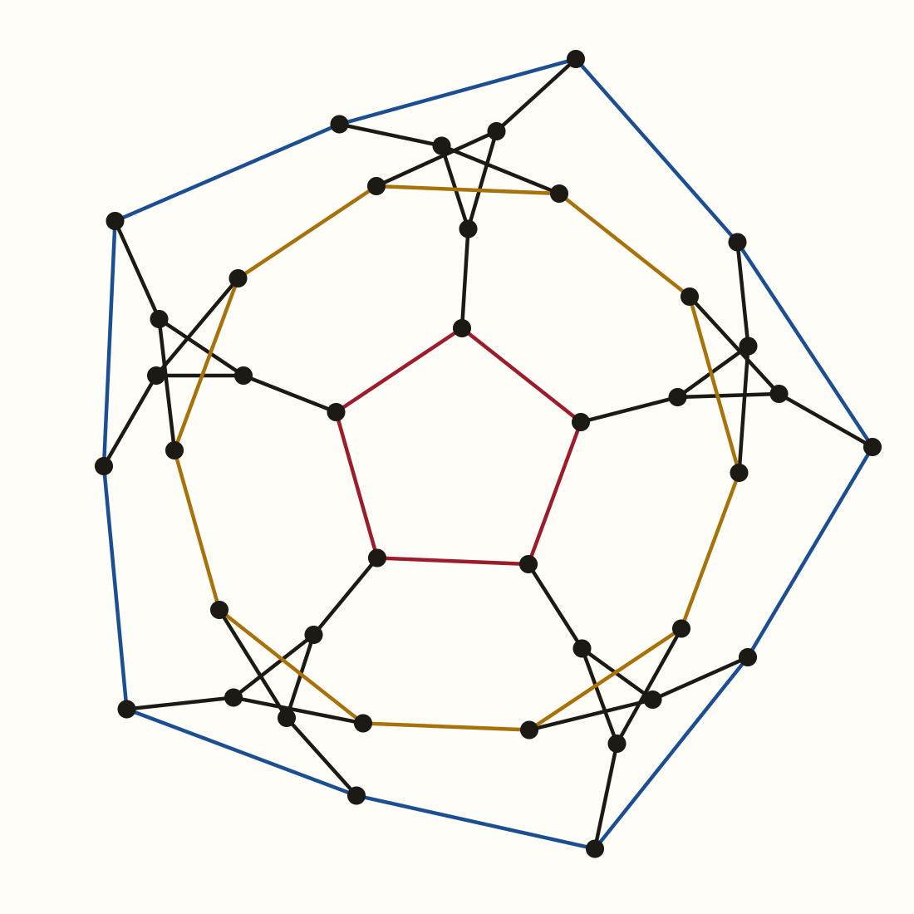
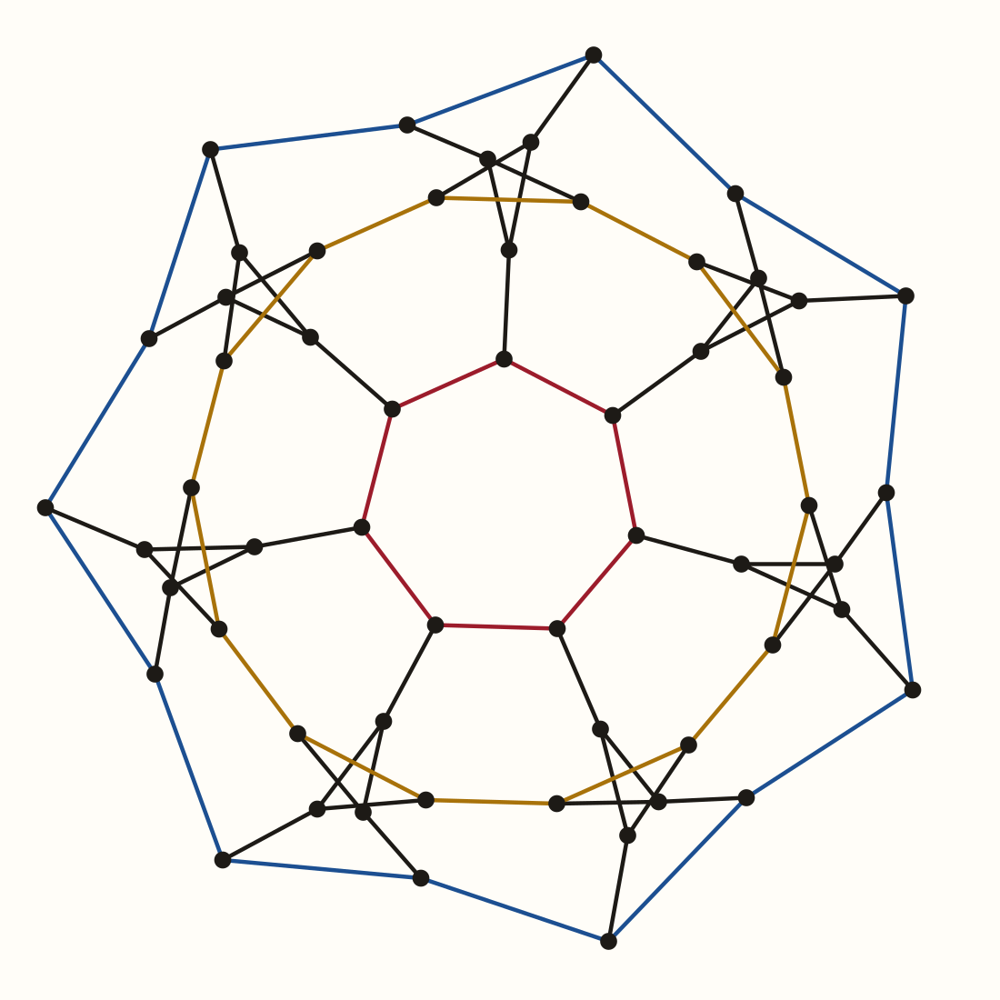
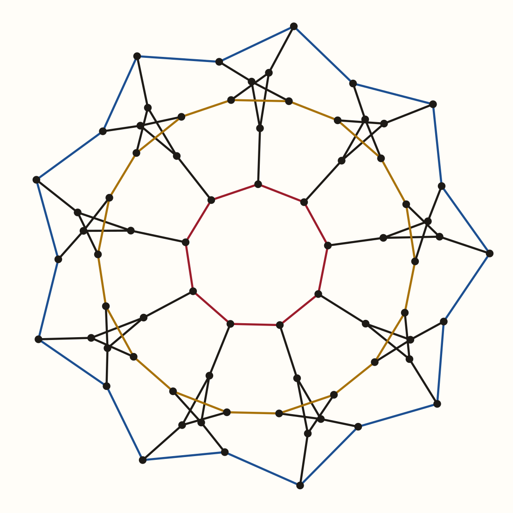
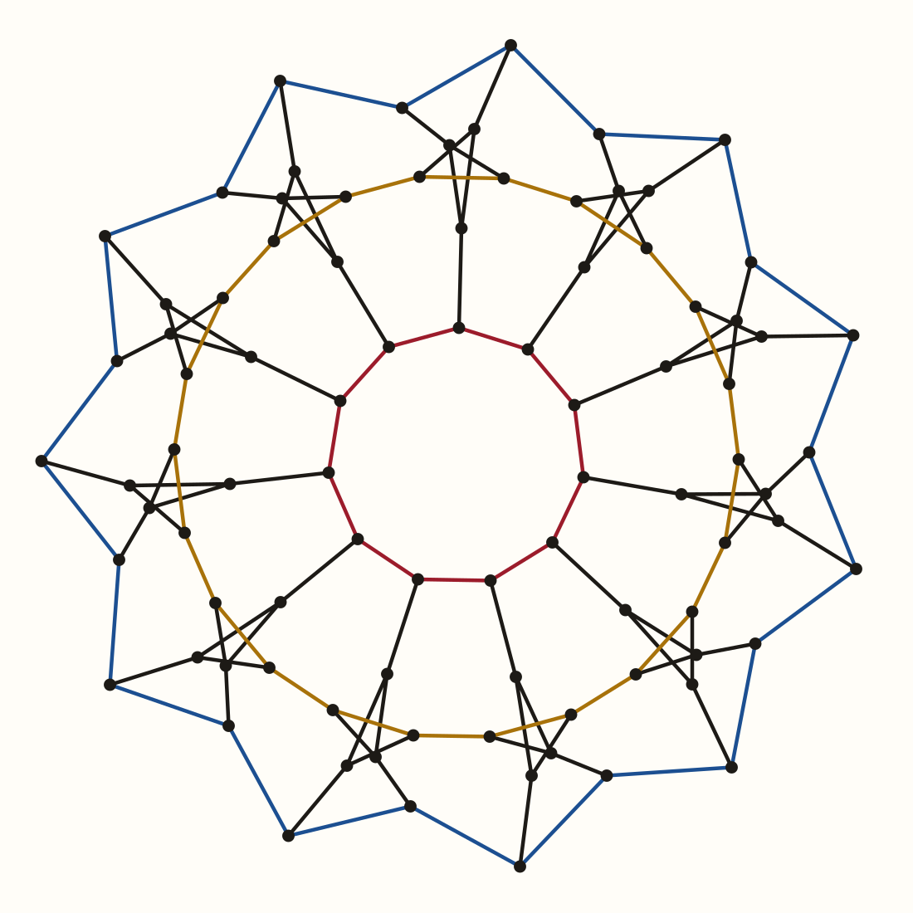
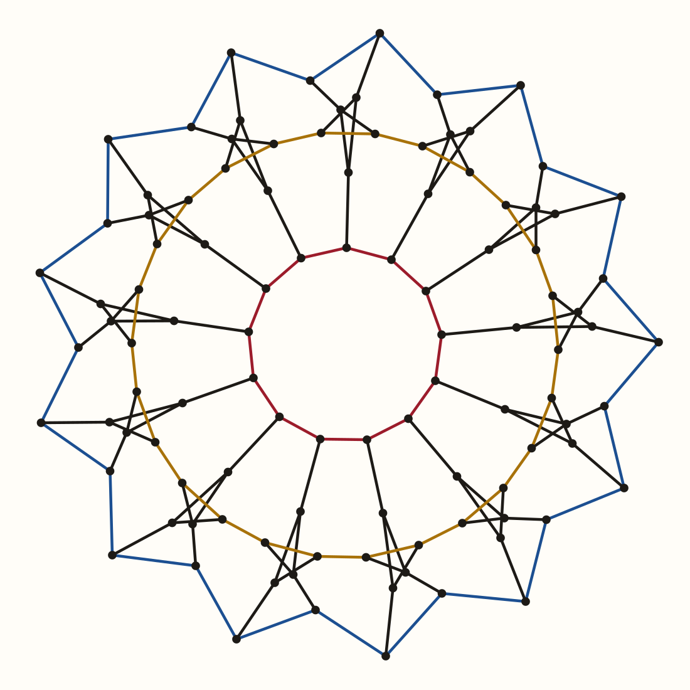
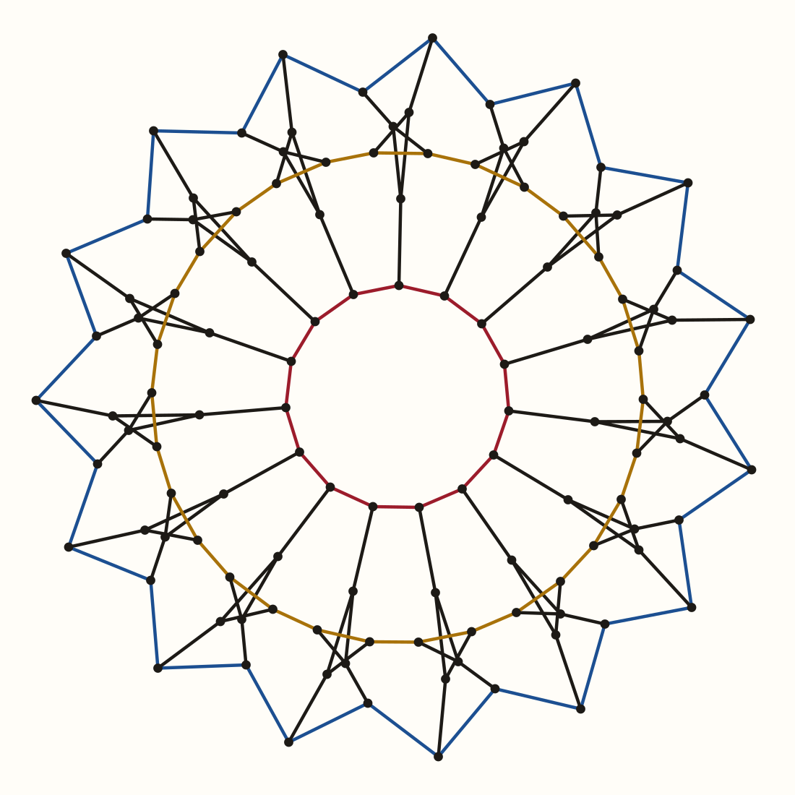

<h1 align="center">Goldberg Snarks</h1>

	A website about Goldberg snarks, a family of graphs.
	🕸️

	<!-- prettier-ignore-start -->
	<!-- ALL-CONTRIBUTORS-BADGE:START - Do not remove or modify this section -->
	
<!-- ALL-CONTRIBUTORS-BADGE:END -->
	<!-- prettier-ignore-end -->
	
	
	

## About

This is the source of [goldbergsnarks.com](https://goldbergsnarks.com).

A _graph_ is a set of points joined by lines.
Most graphs in which three lines meet at every point can have their lines given three colors, so that lines that meet have different colors.
A _snark_ is a graph like that whose lines need four colors, with some exceptions.
The _Goldberg snarks_ are a family of snarks that Mark Goldberg published in 1981.
The six smallest are:

	
	
	
	 
	
	
	

The [homepage](https://goldbergsnarks.com) explains Goldberg snarks in general.
There are also pages for these six, from [G5](https://goldbergsnarks.com/g5) to [G15](https://goldbergsnarks.com/g15), and for [G3](https://goldbergsnarks.com/g3), a related graph that is not a snark.

The site is built with [Astro](https://astro.build).
Its drawings, and most of its numbers, are computed by the code in [`src/graphs`](./src/graphs).

## Development

See [`.github/CONTRIBUTING.md`](./.github/CONTRIBUTING.md), then [`.github/DEVELOPMENT.md`](./.github/DEVELOPMENT.md).
Thanks! 🕸️

## Contributors

<!-- spellchecker: disable -->
<!-- ALL-CONTRIBUTORS-LIST:START - Do not remove or modify this section -->
<!-- prettier-ignore-start -->
<!-- markdownlint-disable -->
<table>
  <tbody>
    <tr>
      <td align="center" valign="top" width="14.28%"><a href="http://www.joshuakgoldberg.com/"> <b>Josh Goldberg</b></a> <a href="https://github.com/JoshuaKGoldberg/goldberg-snarks/commits?author=JoshuaKGoldberg" title="Code">💻</a> <a href="#content-JoshuaKGoldberg" title="Content">🖋</a> <a href="https://github.com/JoshuaKGoldberg/goldberg-snarks/commits?author=JoshuaKGoldberg" title="Documentation">📖</a> <a href="#ideas-JoshuaKGoldberg" title="Ideas, Planning, & Feedback">🤔</a> <a href="#infra-JoshuaKGoldberg" title="Infrastructure (Hosting, Build-Tools, etc)">🚇</a> <a href="#maintenance-JoshuaKGoldberg" title="Maintenance">🚧</a> <a href="#projectManagement-JoshuaKGoldberg" title="Project Management">📆</a> <a href="#tool-JoshuaKGoldberg" title="Tools">🔧</a></td>
    </tr>
  </tbody>
</table>

<!-- markdownlint-restore -->
<!-- prettier-ignore-end -->

<!-- ALL-CONTRIBUTORS-LIST:END -->
<!-- spellchecker: enable -->

> 💝 This repository was templated with [`create-typescript-app`](https://github.com/JoshuaKGoldberg/create-typescript-app) using the [Bingo framework](https://create.bingo).
